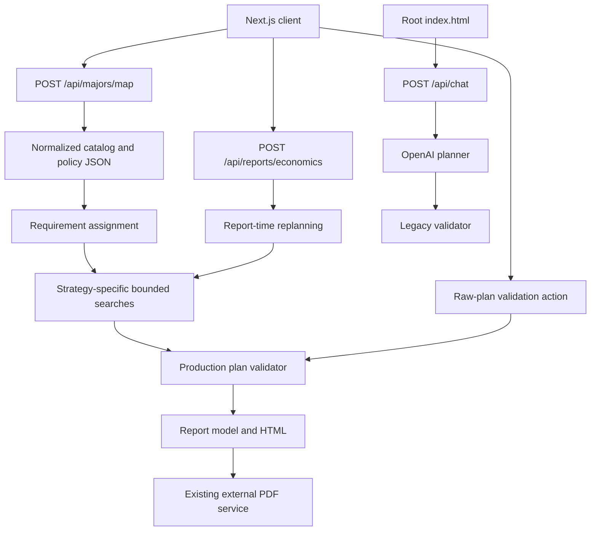

# EconPlanner Planning Knowledge Hub: CP0 current state

## Checkpoint decision

CP0 is characterization only. It adds measurement, provenance, a frozen fictional cohort, a conflict register, and a nightly rerun fix. It does not add the Knowledge Hub, compiler, Decision Engine, signed snapshots, or command edits, and it does not change planner, solver, API, UI, report, or PDF behavior.

The measured planner behavior is exact `origin/main` commit `011a624f13f2cb1b62c1acf550ea91c67c6e71b3`. Instrumentation ran on local branch `codex/oracle-hub-cp0` from a dirty pre-commit worktree while `HEAD` and `origin/main` remained that exact SHA. The local checkpoint commit containing this document is the instrumentation revision; it is intentionally not treated as the behavior baseline SHA.

## Current architecture

There is currently no separately versioned Policy Bundle, Production Decision Engine, immutable validated-plan snapshot, or server-derived destination operation. The active planner searches and validates through overlapping runtime modules; report construction can replan; the legacy LLM route remains reachable through the root HTML page.

## Exact-main frozen cohort

The committed aggregate JSON is [`tests/fixtures/econplanner-architecture-baseline.v2.json`](../../tests/fixtures/econplanner-architecture-baseline.v2.json), and this document is its Markdown form. Local generated copies are stored as `test-results/cp0-baseline/econplanner-cp0-exact-main-aggregate.{json,md}` beside the ignored raw shards; raw shard SHA-256 digests are retained in the fixture.

| Metric | Exact CP0 result |
|---|---:|
| Fictional profiles | 368 |
| Profiles with displayed plans | 186 |
| Profiles without displayed plans | 182 |
| Displayed plans | 441 |
| Plan-count distribution | 182 zero; 42 one; 33 two; 111 three |
| Unexplained no-plan results | 0 |
| Strategy attempts | 1,179 |
| Search attempts | 2,697 |
| Accepted-plan nodes | p50 1,210; p95 154,474; max 250,000 |
| First solver-solution nodes | 460 observations; p50 28; p95 143,075; max 249,047 |
| Node-limit attempts/profiles | 82 attempts across 45 profiles |
| Limit profiles with a legacy validated displayed plan | 33 |
| Unexpected/unclassified Oracle disagreements | 0 / 0 |
| Oracle review findings | 188 |

All 441 displayed plans carry the current `PRELIMINARY_ONLY` feasibility label. The displayed strategy counts are Balanced 158, Staggered 133, Explore First 140, and One Year Early 10. The current distribution validator reports 304 exact and 137 acceptable fits; this is only a strategy-fit proxy and is not the future strategy contract.

The local performance pass used four parallel shards on one shared Windows host. Its profile latency was p50 307.76 ms, p95 16,240.61 ms, and maximum 37,254.79 ms. Only runs with the same host and topology should be compared directly for latency. Node counts are the stable performance baseline.

### Primary coverage is not yet measurable

The 186/368 result is named only `legacyValidationProxy`: the current system displayed at least one plan that passed its existing validator and had no unscheduled courses. It is not `B_COMPLETE` and must not be reported as Decision Engine approval, snapshot issuance, report readiness, or PDF readiness.

`B_COMPLETE` remains `NOT_MEASURED` because CP0 has no Production Decision Engine completion contract, signed snapshot, or per-profile report-build result. The denominator 368 is measured; the numerator and percentage are null. Time to first complete approved plan, nodes to first complete approved plan, exact incumbent preservation, production false negatives, Decision Engine latency, destination classification, compiler performance, and per-profile report readiness also remain explicitly unmeasured.

## No-plan taxonomy

Every no-plan profile has a category and reason:

| Category | Count | Current reasons |
|---|---:|---|
| `INPUT_BLOCKED` | 93 | `INVALID_INPUT` |
| `SEARCH_INCOMPLETE` | 12 | `SEARCH_INCOMPLETE` |
| `INFEASIBLE_PROVEN` | 77 | 57 `COUNT_CAPACITY`; 20 `NO_COMPLETE_ASSIGNMENT` |

Incomplete searches are classified before capacity or empty-domain evidence and are never labeled infeasible. Text that merely suggests a missing offering is `SCHEDULE_BLOCKED` with an unknown conclusion unless structured complete-schedule evidence exists.

## Conflict freeze

These are frozen target interpretations pending project-owner approval. CP0 records them but does not activate them:

| Topic | Frozen target interpretation |
|---|---|
| ECO 213/214 | Exact active schedules control published terms. Recurring evidence may project unpublished years but never creates a universal same-term academic prohibition. |
| Two-ECO load | Total course capacity is hard. Two Economics courses is a preference; graduation-required heavier loads may remain valid within total capacity with a warning. |
| ECO 257 | Statistics-only remains hard. Canonical activation must wait for governed August 3 confirmation evidence. |
| Unsupported future terms | Use academic-year TBC or preliminary status unless an exact schedule or governed recurring pattern supports a term. |
| Completed advanced courses | Preserve history. Missing historical prerequisite evidence yields review; planned and in-progress timing remains strict. |
| Spring/May | Future internal canonical term is `MAY`; aliases remain accepted and display remains “Spring/May.” |
| Enrollment state | `FULL` remains review-required until governed policy resolves it; it is not silently open or closed. |
| Schedule absence | Absence proves not offered only for a matching active release with complete term coverage; partial or unknown absence stays unknown. |
| Strategy distribution | Strategy fit is ranking metadata and does not make an otherwise valid complete plan invalid. |
| Production/Oracle | The 118 known prerequisite scenario differences and four known allocation differences must be resolved or retained as named review outcomes before authority changes. |

## Nightly rerun behavior

The prior workflow sent start/final notifications only on attempt 1, but its job-level guards also prevented rerun attempts from aggregating raw artifacts. CP0 separates those responsibilities:

- Every attempt records a start time, aggregates available artifacts, uploads the final aggregate, appends the Markdown summary, and enforces RED correctness.
- Start and final email delivery remain attempt-1-only, preventing duplicate notifications.
- Notification success is required only on attempt 1; aggregate RED is enforced on every attempt.
- Shards reject mixed repository, commit, origin, branch, workflow, run, generator, Oracle, schedule, or metric-schema provenance when those values are present. A partial rerun may reuse earlier attempts from the same run; the aggregate records every input attempt and rejects any artifact newer than the current attempt.
- Aggregate runtime identity cannot overwrite a different shard identity, and Markdown now carries commit, origin, run, attempt, and worktree provenance.

## Owner gates and rollback

CP0 remains pending until the project owner approves the 368-profile cohort, the fact that `B_COMPLETE` is not yet measurable, the later five-percentage-point target, and the frozen conflict interpretations. CP1 is not authorized by this checkpoint.

Rollback is a normal Git revert of the single CP0 checkpoint commit. It removes only characterization tests, documentation, metric output, provenance checks, and rerun aggregation behavior; no runtime planner migration or data conversion needs reversal.
